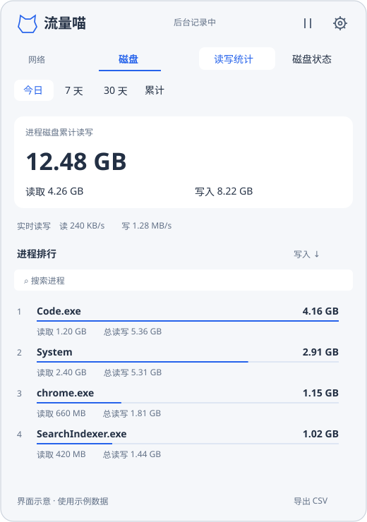

# 流量喵 Windows

一个原生 Windows 托盘工具，查看应用网络流量、进程磁盘读写和 NVMe 状态。C++20 / Win32 / Direct2D；数据保存在本机，无需账号。

[介绍站点](https://tab16360.github.io/flowcat/windows/) · [下载安装包](https://github.com/tab16360/flowcat-windows/releases/latest/download/FlowCat-Windows-x64-Setup.exe) · [更新记录](CHANGELOG.md) · [macOS 版](https://github.com/tab16360/flowcat)



## 使用

支持 Windows 10 22H2 / Windows 11 x64。下载安装器并允许管理员授权。安装后，左键点击托盘猫咪打开面板，右键暂停记录、打开设置，或选择“完全退出”停止采集。

- **后台采集服务**：随系统启动。退出托盘后继续记录，日常界面以普通权限运行。“完全退出”会保存统计并停止服务，再次打开应用会恢复服务（保留原有暂停选择）；服务仍会在下次系统启动时启动。
- **进程排行**：网络应用与代理分开展示，磁盘默认按写入排序；支持搜索、排序和每日 CSV 导出。
- **历史范围**：网络支持今日、昨日、本月；磁盘支持今日、7 天、30 天和累计。
- **按 Wi-Fi 查看**：按真实网络名称筛选，点击当前连接快速切换；无法识别时仍可查看全部网络。
- **磁盘状态**：读取可用的 NVMe SMART 温度、耐久度已用、累计主机读写、通电时间和介质错误。
- **设置与更新**：控制登录时显示托盘、Wi-Fi 识别、每日更新检查；有新版本时可下载安装并重启。

## 安装、升级与卸载

安装和升级需要一次 UAC 授权。更新器只接收本仓库的 Windows 安装包，并验证发布摘要、文件大小和版本。安装器会先停止旧服务、保留上一版程序，在新服务安装失败时尝试恢复旧版。统计数据库不随程序文件替换。

在 Windows“已安装的应用”中卸载。卸载会停止并移除采集服务，清理登录启动项，**保留历史数据及其隐私设置**。历史目录为 `%ProgramData%\FlowCatWindows`，权限限制为系统、管理员及安装账户；普通托盘进程不能修改数据库。原 0.1 预览版历史在首次安装时复制迁移，原文件保留。

当前程序和安装包暂未进行 Authenticode 商业证书签名。

## 统计口径

网络使用 ETW 的 TCP/UDP、IPv4/IPv6 事件，忽略回环。物理网卡总量独立采样，应用与代理排行不可相加。网络流量当前包含互联网和局域网；Wi-Fi 筛选只作用于网络页。读取不到网络名称的时间段只计入“全部网络”，不建立“未分类”条目。

磁盘使用物理 Disk I/O 完成事件。缓存读取可能没有物理 I/O，延迟写入可能归属于系统；无法可靠归属的事件单列，不强行分给应用。不同可执行路径分别统计，尚未按父应用合并所有辅助进程。进程 I/O 不等于 NAND 实际写入，Windows 与 macOS 的磁盘统计口径也不同。

磁盘指标缺失时显示“未提供”。耐久度已用可以超过 100%，不是剩余寿命预测；“无关键警告”只表示 SMART 关键警告位为空，不代表所有健康指标都正常。SATA/USB SMART 暂未适配。

只统计服务运行期间观察到的数据，安装前历史无法补算。内存聚合，每分钟保存，正常停止时再保存；异常断电可能丢失最近一分钟。多网卡/VPN、休眠与长时间运行仍需更多实机测试。

## 开发

安装 Visual Studio 2022 Build Tools 的 C++ 桌面工作负载（含 Windows SDK 和 CMake），然后运行：

```powershell
.\build.ps1
```

安装 Inno Setup 6 后构建安装器：

```powershell
.\package.ps1 -SkipBuild
```

输出在 `dist/`。`FlowCat.exe` 是普通权限界面；`FlowCatService.exe` 是独立采集服务。它们通过仅限安装账户/管理员访问的本地命名管道通信，客户端核对服务 PID，IPC 不接受任意文件路径或执行命令。

SQLite 从 Windows 的 `winsqlite3.dll` 加载。JSON 使用随源码附带的 nlohmann/json 3.12.0（MIT）；其许可证见 `vendor/`。核心、持久化和更新检查由构建脚本运行，实机记录见 [VALIDATION.md](VALIDATION.md)。

MIT 开源。

自动构建配置模板位于 `ci-preview.yml`，尚未写入 GitHub Actions 工作流目录；启用时需使用具备 workflow 权限的凭据。当前安装包由 Surface 实机构建和验证。
